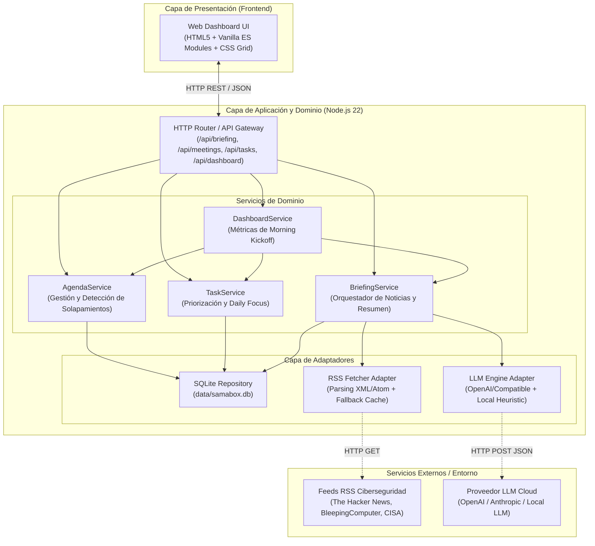
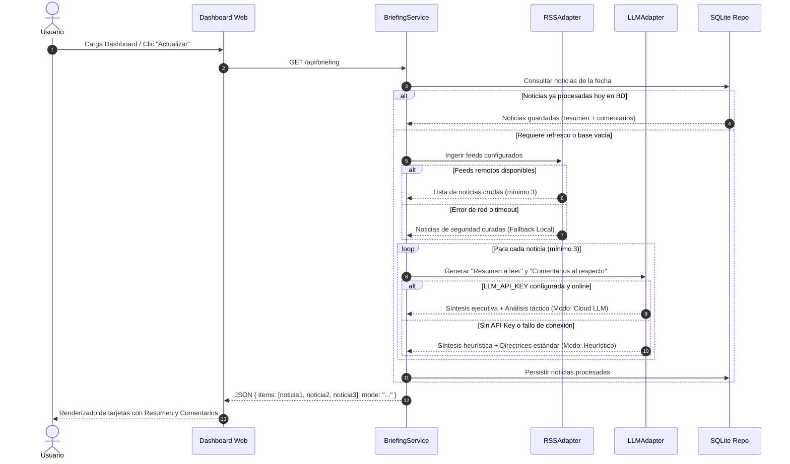
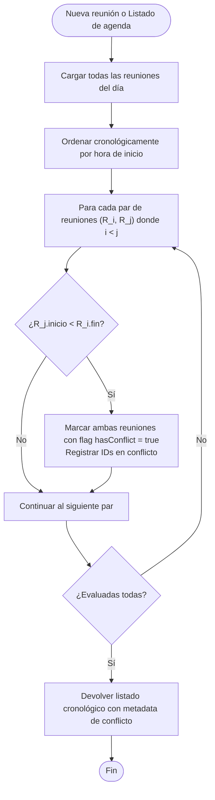

# Architecture & Design Document - Samabox

## 1. Visión General y Principios de Diseño

**Samabox** está concebido bajo una arquitectura modular limpia (*Modular Clean Architecture*), altamente desacoplada y orientada a ser construida mediante **Test-Driven Development (TDD)** estricto.

### Principios Rectores:
1. **Separación de Responsabilidades**: Las reglas de negocio (solapamiento de agenda, priorización de tareas, análisis de resúmenes) residen en el Dominio y Servicios, aisladas de la infraestructura HTTP y persistencia.
2. **Resiliencia por Diseño (Graceful Degradation)**: Si los proveedores externos (RSS, API LLM remota o conexión a internet) fallan, el sistema degrada automáticamente a fuentes y motores heurísticos locales sin interrumpir la experiencia del usuario.
3. **Cero Dependencias Complejas / Fast TDD**: Implementado en Node.js v22 LTS aprovechando el motor de pruebas nativo (`node:test`, `node:assert/strict`) y base de datos SQLite integrada. Esto garantiza ejecución de pruebas en milisegundos sin dependencias pesadas.
4. **Dashboard Ligero y Responsivo**: Frontend interactivo en Vanilla Modern ES Modules y CSS Grid/Flexbox, eliminando pasos de compilación (sin webpack/vite obligatorio) para despliegue instantáneo y depuración transparente.

---

## 2. Diagramas de Arquitectura (Mermaid)

### 2.1 Diagrama de Contenedores y Capas (C4 Level 2)



---

### 2.2 Flujo del Daily Security Briefing (Resiliencia & Fallback)



---

### 2.3 Algoritmo de Detección de Solapamientos de Agenda



---

## 3. Stack Tecnológico y Justificación

| Componente | Tecnología | Justificación |
| :--- | :--- | :--- |
| **Runtime** | **Node.js v22 LTS** | Soporte moderno para ES Modules, fetch nativo, motor de pruebas integrado `node:test` y SQLite integrado. |
| **Backend & Routing** | **Node.js HTTP / Express Micro-core** | Manejo declarativo de rutas REST, middleware JSON, servicio de estáticos y control de excepciones. |
| **Persistencia** | **SQLite (archivo local `data/samabox.db`)** | Cero configuración externa, ACID, transaccional, ultrarrápido y soporta base de datos en memoria (`:memory:`) para tests. |
| **Testing Framework** | **`node:test` + `node:assert/strict`** | Framework de pruebas oficial de Node.js, tiempo de inicio de 15 ms, sin dependencias de terceros, soporte para suites unitarias e integración. |
| **Frontend Web** | **Vanilla HTML5 + Modern CSS + ES Modules** | Rendimiento óptimo, sin transpiladores ni paso de compilación pesado, modular y responsive con CSS Grid. |
| **Adaptador IA** | **OpenAI Compatible Client + Heuristic Fallback** | Integración directa mediante `fetch` nativo con cualquier LLM compatible y degradación elegante a análisis heurístico local. |

---

## 4. Estructura de Directorios del Proyecto

```
samabox/
├── .gitignore
├── package.json
├── docs/
│   ├── PRD.md
│   └── ARCHITECTURE.md
├── data/
│   └── .gitkeep
├── src/
│   ├── config.js                      # Configuración centralizada y variables de entorno
│   ├── server.js                     # Punto de entrada y arranque del servidor HTTP
│   ├── app.js                        # Configuración de rutas, middlewares y servidor
│   ├── domain/                       # Modelos de dominio puros y reglas de negocio
│   │   ├── meeting.js                # Validación de horarios y detección de solapamientos
│   │   ├── task.js                   # Estados, prioridades y lógica de Daily Focus
│   │   └── briefing-item.js          # Estructura del briefing (resumen + comentarios)
│   ├── services/                     # Casos de uso de la aplicación
│   │   ├── agenda-service.js         # Lógica de creación, listado y solapamiento
│   │   ├── task-service.js           # Lógica de priorización y filtrado de tareas
│   │   ├── briefing-service.js       # Orquestador RSS + LLM/Heurística + Caché
│   │   └── dashboard-service.js      # Consolidación de métricas de Morning Kickoff
│   ├── adapters/                     # Implementaciones de infraestructura
│   │   ├── db.js                     # Inicializador y repositorio SQLite
│   │   ├── rss-adapter.js            # Lector de feeds RSS/Atom y fallback curado
│   │   └── llm-adapter.js            # Adaptador LLM (Cloud + Motor Heurístico)
│   └── public/                       # Frontend Dashboard (Single Page / Vanilla)
│       ├── index.html                # Estructura visual de tres columnas
│       ├── css/
│       │   └── styles.css            # Estilos responsivos, tokens de color, modo oscuro
│       └── js/
│           ├── api.js                # Cliente HTTP para llamadas al backend
│           ├── components/
│           │   ├── briefing-view.js  # Render de noticias, resúmenes y comentarios
│           │   ├── agenda-view.js    # Render de reuniones y alertas de conflicto
│           │   └── task-view.js      # Render de tareas, prioridades y focus
│           └── app.js                # Orquestador del Dashboard en cliente
└── tests/
    ├── helpers/
    │   └── test-db.js                # Base de datos en memoria para pruebas
    ├── unit/
    │   ├── meeting-domain.test.js    # Tests unitarios del algoritmo de solapamiento
    │   ├── task-domain.test.js       # Tests unitarios de estados y prioridades
    │   └── llm-adapter.test.js       # Tests del adaptador LLM y fallback heurístico
    └── integration/
        ├── agenda-api.test.js        # Tests de endpoints de Agenda
        ├── task-api.test.js          # Tests de endpoints de Tareas
        ├── briefing-api.test.js      # Tests de endpoints de Briefing
        └── dashboard-api.test.js     # Tests del resumen de Morning Kickoff
```

---

## 5. Modelo de Datos y Esquema SQLite

### 5.1 Tablas Principales

```sql
-- Tabla: meetings (Agenda)
CREATE TABLE IF NOT EXISTS meetings (
    id TEXT PRIMARY KEY,
    title TEXT NOT NULL,
    start_time TEXT NOT NULL,       -- Formato 'HH:MM' (ej. '09:30')
    end_time TEXT NOT NULL,         -- Formato 'HH:MM' (ej. '10:15')
    date TEXT NOT NULL,             -- Formato 'YYYY-MM-DD'
    location TEXT DEFAULT '',
    notes TEXT DEFAULT '',
    created_at TEXT NOT NULL,
    updated_at TEXT NOT NULL
);

-- Tabla: tasks (Pendientes y Enfoque Diario)
CREATE TABLE IF NOT EXISTS tasks (
    id TEXT PRIMARY KEY,
    title TEXT NOT NULL,
    priority TEXT NOT NULL CHECK(priority IN ('Alta', 'Media', 'Baja')),
    status TEXT NOT NULL CHECK(status IN ('Pendiente', 'En Progreso', 'Completada')),
    is_focus INTEGER NOT NULL DEFAULT 0, -- 1 si es Enfoque del Día, 0 si no
    date TEXT NOT NULL,             -- Formato 'YYYY-MM-DD'
    created_at TEXT NOT NULL,
    updated_at TEXT NOT NULL
);

-- Tabla: briefing_items (Noticias de Seguridad Procesadas)
CREATE TABLE IF NOT EXISTS briefing_items (
    id TEXT PRIMARY KEY,
    title TEXT NOT NULL,
    url TEXT NOT NULL,
    source TEXT NOT NULL,
    published_at TEXT NOT NULL,
    summary TEXT NOT NULL,          -- "Resumen a leer"
    commentary TEXT NOT NULL,       -- "Comentarios al respecto" (Impacto y Riesgos)
    analysis_mode TEXT NOT NULL,    -- 'LLM_CLOUD' o 'HEURISTIC_LOCAL'
    briefing_date TEXT NOT NULL,    -- Formato 'YYYY-MM-DD'
    created_at TEXT NOT NULL
);
```

---

## 6. Especificación de la API REST

| Método | Endpoint | Descripción | Body (Entrada) | Respuesta Exitosa |
| :--- | :--- | :--- | :--- | :--- |
| `GET` | `/api/health` | Estado del sistema y almacenamiento | Ninguno | `{ status: "ok", mode: "...", timestamp: "..." }` |
| `GET` | `/api/dashboard/summary` | Resumen global para Morning Kickoff | Query: `?date=YYYY-MM-DD` | `{ date, briefingCount, meetingStats, taskStats, mode }` |
| `GET` | `/api/briefing` | Obtiene el Daily Security Briefing | Query: `?date=YYYY-MM-DD` | `{ date, mode, items: [...] }` |
| `POST` | `/api/briefing/refresh` | Fuerza recolección y reproceso | `{}` | `{ date, mode, items: [...] }` |
| `GET` | `/api/meetings` | Lista reuniones ordenadas con flag de conflicto | Query: `?date=YYYY-MM-DD` | `[ { id, title, startTime, endTime, hasConflict, ... } ]` |
| `POST` | `/api/meetings` | Registra nueva reunión | `{ title, startTime, endTime, location, notes, date? }` | `201 Created` - `{ meeting }` |
| `PUT` | `/api/meetings/:id` | Modifica reunión existente | `{ title, startTime, endTime, location, notes }` | `200 OK` - `{ meeting }` |
| `DELETE` | `/api/meetings/:id` | Elimina reunión | Ninguno | `204 No Content` |
| `GET` | `/api/tasks` | Lista tareas filtradas/ordenadas | Query: `?date=...&status=...` | `[ { id, title, priority, status, isFocus, ... } ]` |
| `POST` | `/api/tasks` | Crea nueva tarea | `{ title, priority, isFocus?, date? }` | `201 Created` - `{ task }` |
| `PATCH` | `/api/tasks/:id` | Actualiza estado, prioridad o foco | `{ status?, priority?, isFocus? }` | `200 OK` - `{ task }` |
| `DELETE` | `/api/tasks/:id` | Elimina tarea | Ninguno | `204 No Content` |

---

## 7. Estrategia de Pruebas y TDD

El desarrollo del proyecto se ejecutará rigurosamente bajo el ciclo **Red-Green-Refactor**:
1. **Fase Roja (Red)**: Escribir la prueba unitaria o de integración para el caso de uso antes de escribir el código productivo. La prueba debe fallar con un motivo claro.
2. **Fase Verde (Green)**: Escribir el código mínimo necesario en el dominio o servicio para que la prueba pase satisfactoriamente.
3. **Fase de Refactorización (Refactor)**: Mejorar legibilidad, eliminar duplicación y afinar contratos sin alterar el comportamiento verificado.

### Pirámide de Pruebas:
- **Unitarias (Rápidas, aisladas, sin I/O real)**:
  - Algoritmo de solapamiento cronológico de reuniones.
  - Validaciones de formato de hora (`HH:MM`) y rango válido (`inicio < fin`).
  - Matriz de prioridad de tareas y control de límite de `Daily Focus`.
  - Generador heurístico de resúmenes y comentarios de seguridad.
- **Integración (Con base de datos en memoria `:memory:`)**:
  - Operaciones completas del repositorio SQLite.
  - Endpoints HTTP REST (rutas, validación de schemas JSON, códigos de respuesta HTTP 200, 201, 400, 404).
  - Mock de llamadas HTTP en el adaptador RSS y LLM para garantizar resiliencia ante errores de red.

Comando de ejecución de pruebas:
```bash
npm test
# Ejecuta internamente: node --test tests/**/*.test.js
```

---

## 8. Estrategia de Ramas y Flujo Git

- **Rama Principal**: `main` (código estable, probado y documentado).
- **Ramas de Funcionalidad**: `feature/issue-<numero>-<slug-descriptivo>`.
  - Ejemplo: `feature/issue-1-agenda-domain-sqlite`
  - Ejemplo: `feature/issue-2-task-engine-focus`
  - Ejemplo: `feature/issue-3-security-briefing-llm`
  - Ejemplo: `feature/issue-4-unified-dashboard-ui`
  - Ejemplo: `feature/issue-5-e2e-integration-hardening`
- **Convención de Commits**:
  - `feat: <descripción>` para nuevas funcionalidades.
  - `test: <descripción>` para suites de prueba añadidas.
  - `fix: <descripción>` para correcciones de bugs.
  - `docs: <descripción>` para documentación y diagramas.
  - `refactor: <descripción>` para mejoras de estructura de código.

---

## 9. Plan de Issues Secuenciales para TDD

### **Issue #1: Core Domain Models, SQLite Persistence & Agenda Service with Overlap Collision Detection**
- **Descripción**: Establecer la infraestructura base del proyecto (`package.json`, configuración, inicializador SQLite transaccional) e implementar el modelo de dominio y servicio de Agenda. Desarrollar mediante TDD el algoritmo de orden cronológico y detección de solapamientos de horario entre reuniones.
- **Entregables TDD**:
  - Modelo de dominio `Meeting` con validación estricta de horarios (`HH:MM`).
  - Algoritmo de detección de conflictos de agenda para intervalos superpuestos.
  - Adaptador SQLite (`data/samabox.db` y soporte `:memory:` para testing).
  - Endpoints REST `/api/meetings` (GET, POST, PUT, DELETE) con tests de integración.

### **Issue #2: Daily Tasks Engine with Prioritization Matrix & Daily Focus**
- **Descripción**: Implementar el motor de tareas diarias. Soportar ciclo de vida de tareas (`Pendiente`, `En Progreso`, `Completada`), tres niveles de prioridad (`Alta`, `Media`, `Baja`) y la capacidad de marcar y filtrar el `Enfoque del Día` (*Daily Focus*).
- **Entregables TDD**:
  - Modelo de dominio `Task` y validaciones de estados y prioridad.
  - Servicio `TaskService` con filtros por estado, ordenamiento por severidad y cálculo de porcentaje de avance.
  - Persistencia en tabla `tasks` de SQLite.
  - Endpoints REST `/api/tasks` (GET, POST, PATCH, DELETE) con tests de integración.

### **Issue #3: Security Briefing Engine (RSS Feed Ingestion, LLM Commentary & Resilient Heuristic Fallback)**
- **Descripción**: Implementar el orquestador del Daily Security Briefing. Desarrollar el adaptador de ingesta RSS/Atom de ciberseguridad garantizando al menos 3 noticias diarias. Implementar el generador de **"Resumen a leer"** y **"Comentarios al respecto"** mediante proveedor LLM configurable, con mecanismo de conmutación automática (*fallback*) a motor heurístico local ante ausencia de API Key o error de conexión.
- **Entregables TDD**:
  - Adaptador RSS con soporte de feeds remotos y feed mock curado offline.
  - Adaptador LLM con soporte de API externa y motor heurístico local basado en palabras clave y taxonomía de ciberseguridad.
  - Servicio `BriefingService` con almacenamiento en caché en tabla `briefing_items`.
  - Endpoints REST `/api/briefing` y `/api/briefing/refresh` cubiertos por tests.

### **Issue #4: Unified Morning Kickoff Dashboard (Responsive Web Interface & Real-Time API Integration)**
- **Descripción**: Diseñar e implementar la interfaz web interactiva responsive del Dashboard. Presentar el panel de tres columnas para noticias, agenda y tareas, junto con el encabezado de métricas de inicio del día (*Morning Kickoff Summary*). Conectar las interacciones del usuario con la API REST de forma reactiva.
- **Entregables TDD**:
  - Frontend modular en `src/public` (HTML5 semántico, CSS responsivo dark/light, componentes ES Modules).
  - Renderizado de tarjetas de noticias con bloques destacados de Resumen y Comentarios.
  - Renderizado cronológico de agenda con distintivo visual en reuniones con solapamiento.
  - Tablero de tareas con selector de estado y destacado visual para el Daily Focus.
  - Barra de resumen matutino conectada a `/api/dashboard/summary`.
  - Tests de integración de la API del dashboard y pruebas de renderizado.

### **Issue #5: End-to-End System Integration, Health Check & Operational Hardening**
- **Descripción**: Integrar completamente los componentes, verificar flujos de extremo a extremo, implementar endpoint `/api/health`, añadir sanitización de contenido contra XSS y documentar la guía de ejecución y verificación.
- **Entregables TDD**:
  - Endpoint `/api/health` verificando integridad de base de datos y estado de servicios.
  - Sanitizador de HTML para entradas de feeds RSS.
  - Suite de pruebas de integración completa E2E validando el flujo completo de Morning Kickoff.
  - Documentación de inicio rápido y scripts en `package.json` (`npm start`, `npm test`).
